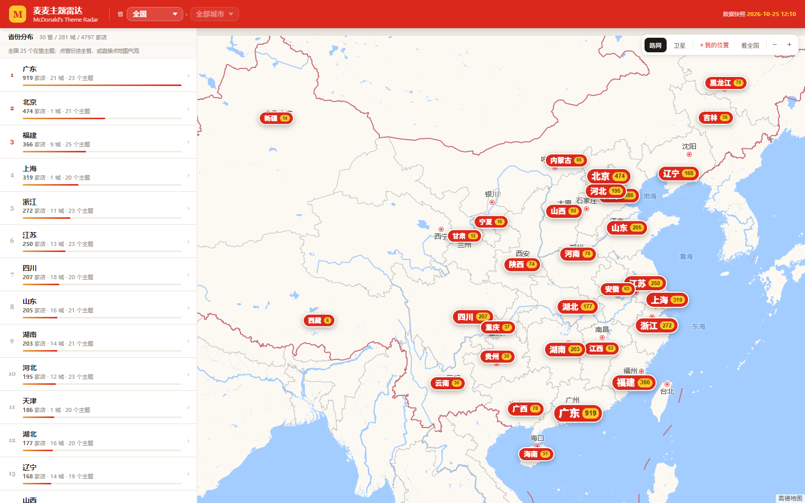
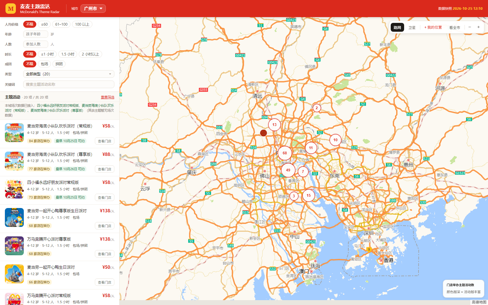
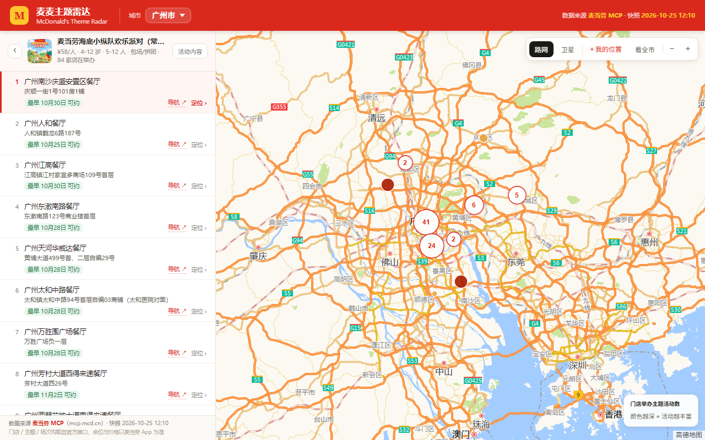

# 麦麦主题雷达 · mcd-theme-radar

> 一句话：**问一句「广州有什么麦当劳主题活动」，得到一张能点、能筛、能导航的活地图。**
> 问一句「全国哪些城市有海底小纵队」，得到一张从全国钻到街道的图。

[](https://mcp.mcd.cn)
[](#安装)
[](#安装)
[](https://holmesz.github.io/mcd-theme-radar/)
[](https://holmesz.github.io/mcd-theme-radar/city.html)

**🔗 在线演示（两套模板，同一份数据）：**

| 版本 | 链接 | 适合 |
|---|---|---|
| **全国版**（省 › 市 两级筛选） | <https://holmesz.github.io/mcd-theme-radar/> | 看覆盖广度、做区域对比、发群里投票 |
| **城市版**（单城市聚焦） | <https://holmesz.github.io/mcd-theme-radar/city.html> | 发给一个具体要去某城的人 |

数据快照 2026-10-25，来源麦当劳官方 MCP。



---

## 一、这是什么

**麦麦主题雷达是一个 WorkBuddy Skill，不是一个网站。**

它把「这周末想去麦当劳办生日会／参加主题派对／带娃去体验营」这件事，从**翻 App 一家家问**变成**一张地图**：

```
用户：我想看看广州的麦当劳主题活动
  ↓
Skill：解析城市 → 调麦当劳 MCP 抓数据 → 缓存 → 渲染单文件地图
  ↓
用户：dist/city.html#city=440100   ← 打开就是这座城市，筛好的
```

### 一个 skill，两套模板

范围大小不同，页面形态就该不同。所以模板有两套，**skill 先判断需求再选**：

| | **城市版** `template/map.html` | **全国版** `template/map_national.html` |
|---|---|---|
| 页头 | 一个「城市」下拉 | 「省 › 市」两级下拉 |
| 首屏 | 直接是该城主题列表 + 门店点 | 全国省份排行榜 + 省级气泡 |
| 层级 | 城市 → 主题 → 门店 | 全国 → 省 → 市 → 主题 → 门店 |
| 全国层级 | — | **不铺门店点**（上万 marker 会卡死），只画省级气泡 |
| 产物体积 | 约 300–400 KB | 全国约 2 MB |
| 生成命令 | `make_city.py --city 广州` | `fetch_snapshot.py --all` + `build_map.py --scope nation` |

判断规则只有一条：**只关心一座城 → 城市版；关心「范围本身」→ 全国版。**

### 范围怎么算：市 / 全省 / 全国

用户嘴里的「范围」只有三种，对应三套完全不同的数字，**不能混着说**：

| 口径 | 含义 | 例（快照 2026-10-25） |
|---|---|---|
| **市** | 一座地级市的可承办门店 | 广州 180 家 / 20 个主题 |
| **全省** | 该省全部地级市合计 | 广东 21 城 919 家 / 23 个主题 |
| **全国** | 30 省 281 城合计 | 4797 家 / 25 个有门店的主题 |

四条口径规则：

1. **省份由城市编码前两位推导**（国标 GB/T 2260，见 `scripts/regions.py`）。不额外调接口，也不需要用户报省名——说「广州」自动归到广东
2. **直辖市只有 1 个「城市」**：北京 / 上海 / 天津 / 重庆的「全省」＝「全市」，两个下拉指向同一批门店，这是正常的
3. **省的边界 ≠ 行政省的边界**：只统计「有可承办门店」的城市。某省若只有 3 个城市有店，省级视图就只有这 3 城
4. **「N 个主题」跟着范围走**：广州 20 个 ≠ 广东 23 个 ≠ 全国 25 个（27 个在售主题里，有 2 个当前无门店举办）

> 所以同一个问题要带上范围说话：
> 「广州 180 家，广东全省 919 家」比单说「180 家」清楚得多。

### 三个关键设计

| 设计 | 含义 |
|---|---|
| **零数据随包分发** | 仓库里没有一份门店数据。数据只在需要时从 `mcp.mcd.cn` 现抓，落到本地缓存，再编译成页面 |
| **产物是单文件页面** | 一个 `html` 自带全部数据，双击可开，可直接丢到任何静态托管 |
| **输出带状态的链接** | `#prov=44&city=440100&spu=17356&price=1` —— agent 把一句自然语言需求翻译成这条 hash，用户点开就是筛好的视图 |

---

## 二、目标用户

| 用户 | 他原本怎么做 | 用了之后 |
|---|---|---|
| **要办生日会的家长** | 在 App 里一家家翻门店、翻套餐、打电话问「这周六还有没有位」 | 打开城市版，选「4-12 岁 / 2 小时 / 拼团」，一眼看到最近 5 家能办的店和可约日期 |
| **组织团建的行政 / HR** | 群里问「哪家能包场 20 人」，等回复等半天 | 筛「包场 + 人数 + 人均预算」，把带 hash 的链接直接甩进群里 |
| **周末想找点事做的年轻人** | 刷小红书看别人去过哪家，自己城市有没有不知道 | 按「主题类型 / 关键词」搜，看这个城市在办哪几个 IP 联名 |
| **跨城比价 / 规划行程的人** | 一个个城市切着查，不知道哪座城选择最多 | 全国版一眼看到各省门店数排行，点进广东看 21 城分布 |
| **麦当劳门店运营 / 加盟商** | 靠内部报表，看不到「同城谁在承办同一个主题」 | 一张图看清全国主题分布与密度，再逐省下钻 |

> 共同点：**他们的问题本质是「空间 + 时间 + 主题」三维匹配，而 App 只给了列表。**
> 这也是本项目切进去的缝——不重复造点餐入口，只补 App 没有的那张图。

---

## 三、它解决的问题

### 1. 门店不是「全都能办」，是「能办哪几种」

实测发现，主题 × 门店是一个**稀疏矩阵**：

- `spuId=17356`（海底小纵队欢乐派对·常规版）在广州有 **84 家**门店可承办
- 同一座城市里，另一个主题只有 **68 家**，且**门店集合不同**
- 同一家店（如 1450713）在两个主题里坐标完全一致，但只在部分主题名单里出现

所以正确的问题是「**这家店能办哪几种主题**」，而不是「这家店能不能办派对」。
这个矩阵，App 不给你看，接口也不会直接给你——要自己按「主题 × 城市」逐次拉、再按门店 `code` 合并去重。这就是本项目数据底座的全部工作量。

### 2. 现抓一次要几百次调用，不能放在页面里

一座城市要 200 次左右调用，广东全省 400+ 次、耗时 7 分 42 秒，全国 5200+ 次。
如果页面每次打开都实时查，用户等不起，Token 还会泄露到前端。
所以架构拆成两段：**构建期抓 + 运行期只读本文件**，页头明确标注「数据快照」。

### 3. 「重点」和「原文」得同时在场

官方购买须知一条动辄两千字，但接口明确规定 **`note` 必须原文展示、不得改写为结构化字段**。
于是详情卡做两个页签：**「重点」**用规则从原文里**切分**出套餐 / 赠品 / 预约（只切不改写，每个 chip 都是原文片段），**「详细原文」**放全文兜底。既好用，又不违反接口约定。

| 全国版 · 省份排行 | 城市版 · 主题列表 | 钻取 · 该主题的门店 |
|---|---|---|
|  |  |  |

---

## 四、核心能力

- **两套模板，按需选择**：单城聚焦 / 全国省市两级
- **任意城市**：覆盖约 281 个地级市，城市名支持 `广州` / `广州市` / `广州天河` 简写匹配
- **七维筛选**：人均价格 / 适龄 / 人数 / 时长 / 包场或拼团 / 主题类型 / 关键词搜主题名
- **两层钻取**：主题卡 → 该主题的门店列表（列表与地图双向联动，自动选中第一家）
- **三层钻取（全国版）**：全国省份排行 → 全省主题 → 全市门店
- **详情双层**：重点（套餐按「主食/小食/饮料/玩具」分行，互斥项合成「A 或 B」）+ 原文
- **场次级信息**：可约日期与场次余位（按需查询，默认覆盖门店最多的前 3 个主题）
- **一键导航**：高德 URI API，门店弹窗与列表行都有入口
- **坐标零偏移**：接口返回 GCJ-02，直接配高德瓦片
- **增量缓存 + 断点续跑**：换城市只补缺失部分，429 自动退避，中断后 `--rebuild` 出中间态
- **零第三方依赖**：纯 Python 标准库 + 纯 HTML/CSS/JS

---

## 五、实测数据（不是估算）

### 城市级：广东全省 21 城

| 环节 | 调用 | 耗时 |
|---|---|---|
| 城市索引（首次，之后复用） | 16 | ~7 秒 |
| 27 个主题详情（首次，之后复用） | 27 | ~12 秒 |
| 全省 21 城门店 | ~400 | 7 分 42 秒 |
| 场次抽样（广州 95 店 + 湛江 24 店 × 6 主题） | ~700 | ~4 分钟 |

结果：**21 城 919 家可承办门店** —— 广州 180、佛山 145、深圳 141、东莞 87、汕头 54……最小的韶关也有 7 家。
主题 27 个，价格区间 **25–198 元/人**。

单城首跑约 200 次调用、1 分钟左右（湛江实测 1 分 06 秒）；第二座城市起，城市索引与主题详情全部命中缓存，只剩门店与场次调用。

### 全国级：281 城

| 环节 | 调用 | 耗时 |
|---|---|---|
| 主题覆盖城市（27 主题） | 27 | ~30 秒 |
| 全国门店（281 城 × 覆盖主题） | **5224** | 单进程约 90 分钟 |
| 编译单文件页面 | 0 | 约 3 秒 |

结果：**281 城 / 30 省 / 4797 家可承办门店**，在售 27 个主题中 25 个有门店举办，单文件 **1.9 MB**。

| 排名 | 省 | 门店 | 城市 | 主题 |
|---|---|---|---|---|
| 1 | 广东 | 919 | 21 | 23 |
| 2 | 北京 | 474 | 1 | 21 |
| 3 | 福建 | 366 | 9 | 25 |
| 4 | 上海 | 319 | 1 | 20 |
| 5 | 浙江 | 272 | 11 | 23 |

抓取按省级优先级排序（直辖市 → 华东 → 西南 → 华中 → 华北 → 西北 → 东北），**跑完一个省就是一份可用快照**，不必等全国跑完。
中断后重跑全部命中缓存；`fetch_snapshot.py --rebuild` 可只用本地缓存重建中间态。

---

## 六、安装

### 前置条件

1. **麦当劳 MCP Token**：在 [mcp.mcd.cn](https://mcp.mcd.cn) 登录 → 控制台 → 激活 → 复制 Token
2. **Python 3.9+**（脚本只用标准库，不需要 `pip install` 任何东西）
3. **WorkBuddy**（推荐，用于自然语言驱动）或任意能跑 Python 的终端

### 1. 接入麦当劳 MCP

WorkBuddy → 左侧【专家·技能·连接器】→【连接器】→ 右上角【自定义连接器】→【配置 MCP】，填入：

```json
{
  "mcpServers": {
    "mcd-mcp": {
      "type": "streamablehttp",
      "url": "https://mcp.mcd.cn",
      "headers": {
        "Authorization": "Bearer YOUR_MCP_TOKEN"
      }
    }
  }
}
```

> 把 `YOUR_MCP_TOKEN` 换成真实 Token 后再保存。**Token 不要提交进仓库。**

### 2. 安装 Skill

```bash
git clone https://github.com/HolmesZ/mcd-theme-radar.git
mkdir -p ~/.workbuddy/skills
cp -r mcd-theme-radar ~/.workbuddy/skills/
```

装好后在 WorkBuddy 里直接说「我想看广州的麦当劳主题活动」，它会读 `SKILL.md` 自行选模板、执行。

### 3. 只跑脚本（不用 WorkBuddy）

```bash
cd mcd-theme-radar/scripts
export MCD_MCP_TOKEN="你的Token"      # Windows: set MCD_MCP_TOKEN=...
```

Token 读取顺序：环境变量 `MCD_MCP_TOKEN` → `~/.workbuddy/mcp.json` 里的 `Authorization: Bearer`。

---

## 七、使用示例

### 示例 1：自然语言（推荐）

```
用户：我下周六想带孩子去麦当劳过生日，广州哪家店能办？
Skill：→ 判断这是「只看一座城」→ 城市版
      → python make_city.py --city 广州
回复：广州 180 家餐厅可承办主题活动，覆盖 20 个主题，45–138 元/人。
     门店最多的是「海底小纵队欢乐派对（常规版）」，84 家店在举办；
     可约日期从今天 +3 起共 7 天。广州有 95 家店已接入场次数据。
     页面：dist/city.html#city=440100
```

```
用户：全国哪些城市有海底小纵队？哪个省最多？
Skill：→ 判断涉及「范围本身」→ 全国版
      → python fetch_snapshot.py --all && python build_map.py --scope nation
回复：广东 919 家最多（21 城），北京 474、福建 366 次之；
     海底小纵队常规版在 279 城有门店，共 4050 家。
     页面：dist/nation.html#spu=17356
```

### 示例 2：城市版，一条命令跑完

```bash
cd scripts

python make_city.py --city 广州                     # 单城：抓取 + 渲染，约 1 分钟
python make_city.py --city 深圳 --skip-slots        # 只抓门店，最快
python make_city.py --city 广州 --spus 5 --dates 3  # 更多主题 / 更多日期（调用量线性上涨）
python make_city.py --list                          # 看支持哪些城市
```

一条命令做完六件事：

| 步骤 | 动作 | 缓存 |
|---|---|---|
| 1 | 城市名 → 城市编码 | `data/raw/_city_index.json` |
| 2 | 27 个主题详情（与城市无关，只抓一次） | `data/spus_detail.json` |
| 3 | 从购买须知提炼「重点」 | `data/highlights.json` |
| 4 | 该城市的可承办门店 | `data/stores.json` |
| 5 | 门店最多的前 3 个主题的日期与场次 | `data/slots.json` |
| 6 | 用城市版模板编译 | `dist/city.html` |

### 示例 3：全国版，先抓后编

```bash
cd scripts

python fetch_snapshot.py --all        # 全国 281 城，约 5200 次调用
python build_map.py --scope nation    # → dist/nation.html

# 只想先看某个省：抓完一个省就能编
python build_map.py --scope nation --pages   # 另外写 docs/index.html 供托管
```

中途想出不完整版本：

```bash
python fetch_snapshot.py --rebuild    # 不调接口，只用 data/raw 缓存重建
python build_map.py --scope nation
```

### 示例 4：带状态的深链

```
dist/nation.html                              # 全国省份排行
dist/nation.html#prov=44                      # 广东全省
dist/nation.html#prov=44&city=440100          # 广州市
dist/city.html#city=440100&price=1&kw=生日     # 城市版 + 筛选
```

可叠加参数：`prov` `city` `spu` `price` `dur` `type` `age` `people` `cat` `kw`。
城市版链接里只有 `city` 时，全国版会自动反推省份——所以 `#city=440100` 两边都能用。

---

## 八、它是怎么工作的

```
                    ┌──────────────────────────────────────────┐
   一句话需求 →      │  SKILL.md  选模板 / 城市解析 / 话术红线     │
                    └───────────────┬──────────────────────────┘
                                    │
              ┌─────────────────────┴─────────────────────┐
              ↓ 只问一座城                                 ↓ 问范围
        make_city.py                              fetch_snapshot.py --all
              ↓                                           ↓
   麦当劳 MCP  ┌──────────┬──────────┬──────────┬──────────┐
  mcp.mcd.cn → │ 主题清单  │ 覆盖城市  │ 门店+坐标 │ 主题详情  │
                └────┬─────┴────┬─────┴────┬─────┴────┬─────┘
                     └──────────┴──────────┴──────────┘
                                    ↓ 按门店 code 合并去重
                          data/*.json（本地缓存，不进仓库）
                                    ↓ build_map.py --scope city|nation
              template/map.html  ←──┤├──→  template/map_national.html
                                    ↓
                   dist/city.html（单城） / dist/nation.html（省市两级）
```

---

## 九、用到的麦当劳 MCP 能力

只用了 **1 个 MCP 服务端**（`https://mcp.mcd.cn`）、**6 个工具**：

| # | 工具 | 拿到什么 | 作用 |
|---|---|---|---|
| 1 | `mall-points-products` | 27 个在售主题活动 | 主题字典（spuId / 名称 / 类目 / 价格 / 上下架） |
| 2 | `query-party-city` | 覆盖城市 + 城市中心坐标 | 决定抓取范围，砍掉无效调用 |
| 3 | `query-party-store` | 整城门店 **+ 真实经纬度** | **全项目唯一有坐标的接口**，地图底座 |
| 4 | `mall-product-detail` | 适龄 / 人数 / 时长 / 成团 / 购买须知 / 配图 | 详情卡、配图、重点提炼的原料 |
| 5 | `query-party-store-date` | 7 天可约日期 | 场次级查询 |
| 6 | `query-party-store-session` | 场次时段 / 余位 / 价格 | 场次级查询 |

省份信息不额外调接口——由城市编码前两位按国标推出来（`scripts/regions.py`）。
接入细节（Streamable HTTP 三步握手、`content[0].text` 的「markdown + JSON」混排解析坑、各字段单位陷阱）见 **[MCP_INTEGRATION.md](MCP_INTEGRATION.md)**。

---

## 十、设计取舍

| 取舍 | 为什么 |
|---|---|
| **保留两套模板而不是合成一套** | 单城页面 300 KB、打开即用；全国页 3–4 MB、多一层省级聚合。硬合成会两头都不讨好：全城视图塞进一个城市下拉很别扭，全国视图压成单城又丢了范围感 |
| **全国层级不铺门店点** | 上万 marker 会让页面卡死。全国看省级气泡 + 排行，进省才铺点 |
| **不做实时查询** | 单城 200 次、全国 5200 次调用，页面打开等不了；且 Token 会暴露到前端 |
| **不做代下单 / 支付** | 涉及交易与用户资金，风险与合规成本都不合适。只给门店名 + 门店编号，引导去官方 App |
| **不预烘全国场次** | 场次按「门店 × 日期」抓，全国 4797 家 × 7 天 = 3.4 万次调用，收益不值。只覆盖广州、湛江，其余如实标注「未接入」 |
| **不用 `query-nearby-stores` 做地图** | 实测其坐标恒为 `0.0`，`searchType` 实际只支持 1/2。不能当数据源 |
| **赠品/餐食不当结构化字段** | 接口明文要求 `note` 原文展示。页面只做折叠，不重排、不编造 |

---

## 十一、数据口径（页面上也这么写）

1. **只含「可承办主题活动的餐厅」，不是麦当劳全部门店**
2. 每个门店的主题数有档位：常规款覆盖大多数门店，稀缺口径（程序员节、豪华礼包、体验营）只有几家到几十家
3. 可约日期只有 **7 天**，且从「今天 +3」开始
4. 场次只对指定主题抓过，其余主题**不显示日期与场次，不做假**
5. 省份排行榜只反映各省**可承办门店数**，不代表门店总数或销量
6. 所有价格、供应状态以麦当劳官方渠道实时结果为准

对应的七条话术红线（写进了 `SKILL.md`，防止 agent 说错话）：

| ❌ 不能说 | ✅ 应该说 |
|---|---|
| 「麦当劳全部门店」 | 「可承办主题活动的餐厅（本市 N 家）」 |
| 「全国一万家麦当劳」 | 「全国 281 城共 N 家**可承办**主题活动的餐厅」 |
| 「广东有 919 个活动」 | 「广东 21 城共 919 家餐厅在举办，覆盖 23 个主题」 |
| 「全国都有场次数据」 | 「场次数据目前只覆盖广州、湛江」 |
| 「含 1 个随机玩具」当结构化字段 | 引用购买须知原文 |
| 「这周六还有 12 个位」 | 「快照时点剩余 12 位，以官方渠道为准」 |
| 任何代下单 / 支付跳转 | 给门店名 + 编号，引导去官方 App |

---

## 十二、目录结构

```
mcd-theme-radar/
├── README.md                 本文件（项目介绍 / 安装 / 使用示例 / 目标用户）
├── CONTEST_DECLARATION.md    参赛声明（官方原文，未改动）
├── MCP_INTEGRATION.md        MCP 接入说明：协议、工具链、字段、坑
├── workbuddy.md              WorkBuddy 开发过程记录
├── SKILL.md                  给 agent 的说明书（选模板、城市解析、话术红线）
├── scripts/
│   ├── make_city.py          城市版一键：解析城市 → 抓取 → 缓存 → 渲染
│   ├── mcp_client.py         Streamable HTTP JSON-RPC 客户端（含 SSE 解析）
│   ├── fetch_snapshot.py     抓城市 → 门店（增量合并，--all 全国 / --rebuild 免调用）
│   ├── fetch_spu_detail.py   抓主题详情（内容 / 赠品 / 配图）
│   ├── fetch_slots.py        抓日期与场次（增量合并）
│   ├── extract_highlights.py 从购买须知切出套餐 / 赠品 / 预约（只切分，不改写）
│   ├── regions.py            城市编码 → 省份，省份排序与分组
│   ├── build_map.py          data + 模板 → 页面（--scope city|nation）
│   └── smoke_test.mjs        Node 桩件冒烟测试（自动识别模板，不开浏览器）
├── template/
│   ├── map.html              城市版模板：单城市下拉
│   └── map_national.html     全国版模板：省 › 市 两级下拉
├── docs/
│   ├── index.html            全国版演示页（build_map.py --scope nation --pages）
│   └── city.html             城市版演示页（build_map.py --city … --pages）
├── assets/                   README 截图
├── data/                     按需抓取的缓存，不进仓库
└── dist/                     本地构建产物，不进仓库
```

---

## 十三、常见问题

**Q：为什么仓库里没有数据？**
A：这是设计。数据随时效变化，且属于接口实时内容。跑一次 `make_city.py` 或 `fetch_snapshot.py` 就会在你本地生成。

**Q：没有 Token 能看效果吗？**
A：能。`docs/index.html`（全国版）和 `docs/city.html`（城市版）都是预构建好的静态页，自带快照，直接打开即可。

**Q：我该用哪个模板？**
A：只关心一座城市 → 城市版；想知道全省 / 全国怎么分布、或者要跨城对比 → 全国版。skill 会自己判断，你也可以直接说「用全国版」。

**Q：两个模板的数据是同一份吗？**
A：是。都读 `data/stores.json`，只是渲染方式不同。抓一次全国，两个模板都能编。

**Q：能用别的城市吗？**
A：能，约 281 个地级市。`python make_city.py --list` 查看。

**Q：地图为什么用高德瓦片？**
A：麦当劳接口返回的坐标是 **GCJ-02**（高德系），配高德底图零偏移；配 OSM 会整体偏约 500 米。瓦片与导航 URI 均无需 key。

**Q：会被限流吗？**
A：限流 600 次/分钟/token。实测速率约 1 次/秒，脚本内置 0.12s 节流、429 退避、断点续跑，正常使用碰不到。

---

## 十四、声明

- 本项目为「麦当劳程序员节创意开发大赛」参赛作品，由参赛者独立开发，**非麦当劳官方产品**。
- 项目输出仅供参考；餐品信息、价格及供应状态以**麦当劳官方渠道**实时结果为准。
- 项目不提供下单、支付、代订能力。
- 仓库中不含任何真实 Token、密钥或个人信息；配置一律使用环境变量占位符。
- 详见 [CONTEST_DECLARATION.md](CONTEST_DECLARATION.md)。

---

<sub>数据来源：麦当劳 MCP（`mcp.mcd.cn`）· 快照时间 2026-10-25 (UTC+8) · 全国 30 省 281 城 4797 家可承办门店 / 27 个主题</sub>
